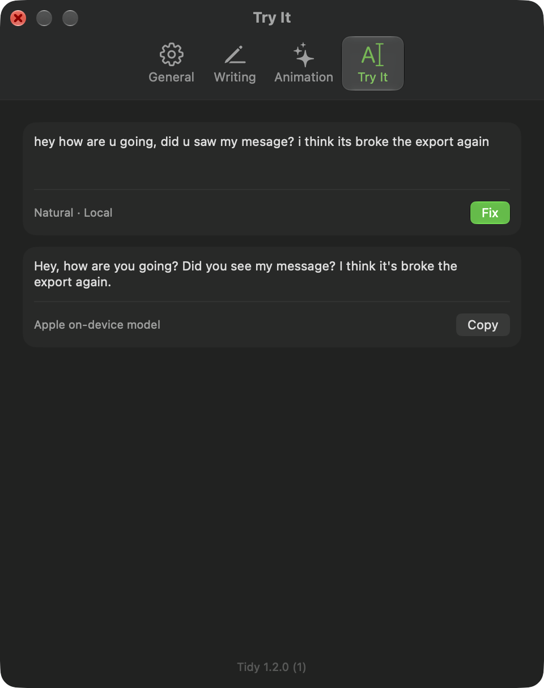
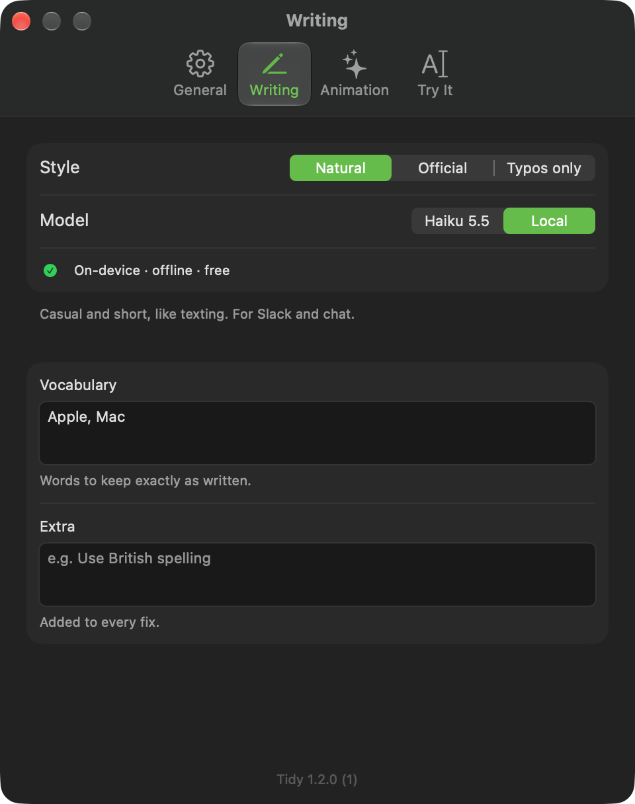
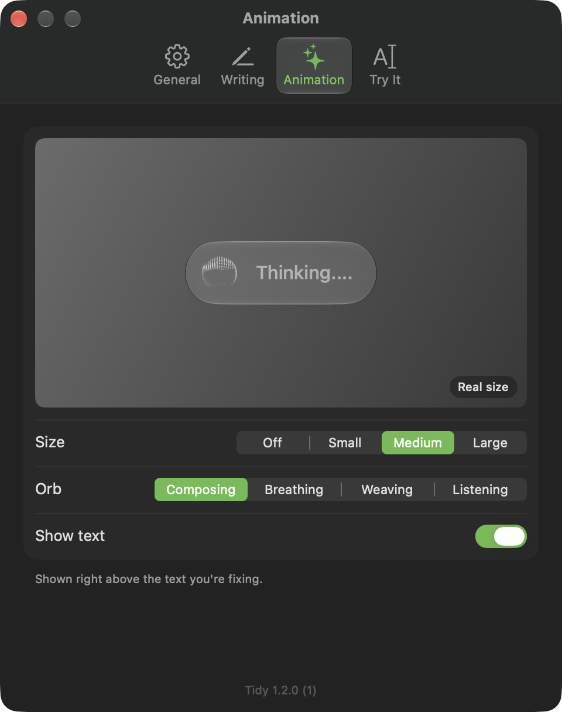
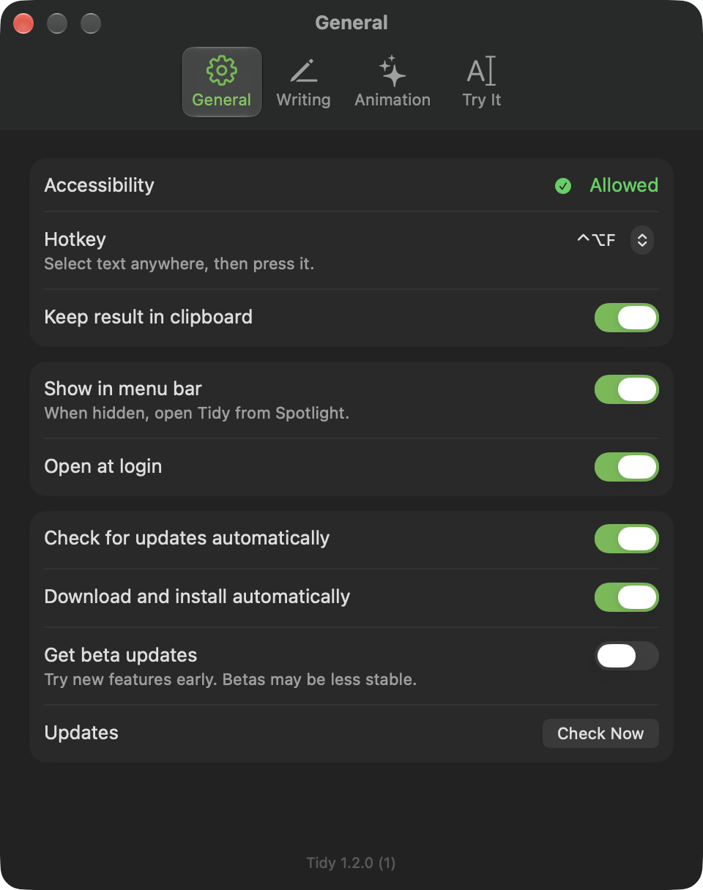

<p align="center">
  
</p>

<h1 align="center">Tidy</h1>

<p align="center">
  Select text anywhere on your Mac, press a hotkey, and it comes back fixed.
</p>

<p align="center">
  <a href="https://github.com/0-LY/tidy/releases/latest/download/Tidy.zip"><b>Download Tidy for macOS</b></a>
  ·
  <a href="https://github.com/0-LY/tidy/releases">All releases</a>
</p>

<p align="center">
  
</p>

## What it does

Select text in any app — mail, chat, notes, a browser, a terminal — and press **⌃⌥F** (you can change it).
Tidy fixes the spelling, grammar and punctuation and puts the result back in place of your selection.
A small glass bubble with an animated orb shows above the text while it works.

| Style | What it does |
|---|---|
| Natural | Casual and short, like texting. For chat. |
| Official | Polite full sentences, no slang. For email. |
| Typos only | Fixes spelling, grammar and punctuation; changes nothing else. |

| Model | Notes |
|---|---|
| Haiku 5.5 | Claude Haiku through your own [Claude Code](https://claude.com/claude-code) login, about 3 seconds. No API key. |
| Local | Apple's on-device model (Apple Intelligence). Offline, free, under a second. Shows which of your keyboard languages it doesn't officially support. |

If Claude is unavailable, Tidy can fall back to the local model.

- **Vocabulary** — words Tidy must keep exactly as written, such as product names.
- **Extra** — your own instruction added to every fix, such as "Use British spelling".
- **Services menu** — right-click selected text → Services → **Fix text**.

<p align="center">
  
  
  
</p>

## Install

1. [Download Tidy.zip](https://github.com/0-LY/tidy/releases/latest/download/Tidy.zip) and unzip it.
2. Move **Tidy.app** to your **Applications** folder.
3. Open it. Tidy isn't notarized by Apple, so the first time macOS says it can't check it:
   click **Done**, open **System Settings → Privacy & Security**, scroll down and click **Open Anyway**.
   You only do this once — updates open normally.
4. Allow **Accessibility** when asked (System Settings → Privacy & Security → Accessibility).
   Tidy needs it to copy your selection and paste the fixed text.

Requirements: macOS 26 or later on Apple silicon. For Haiku, install Claude Code and sign in once (`claude`).
For Local, turn on Apple Intelligence.

## Privacy

- Tidy has no account, no analytics and no tracking.
- Your selected text is sent **only** to the model you choose:
  - **Haiku** — sent to Anthropic through your own Claude Code login and processed under your account's privacy settings.
    Tidy runs Claude with no tools, no files and no saved session.
  - **Local** — never leaves your Mac.
- Nothing you fix is logged or saved. Each fix runs in a private temporary folder that is deleted right away.
- Text Tidy puts on the clipboard is marked as temporary, so clipboard-history apps skip it, and your previous clipboard is restored.
- Settings are stored in `~/.config/tidy/config.json`, readable only by you.
- Update checks fetch `https://github.com/0-LY/tidy/releases/latest/download/appcast.xml`. No system profile is sent.

## Updates

Tidy updates itself. Every update is signed, and Tidy refuses any download whose signature doesn't match the key built into the app.

In **Settings → General** you can turn off automatic checks or automatic installs, check now, or switch on
**Get beta updates** to try new features early.

## Build from source

```sh
git clone https://github.com/0-LY/tidy.git
cd tidy
./build.sh
```

`build.sh` builds `Tidy.app`, installs it into `~/Applications`, adds the **Fix text** service and starts it.
You need the Xcode Command Line Tools (`xcode-select --install`). The first build downloads Sparkle
(pinned version, checked against its SHA-256).

Run a fix from the command line:

```sh
echo "helo wrld" | ./fixer --style minimal --model local
```

| File | Purpose |
|---|---|
| `Tidy.swift` | App, menu bar, settings window |
| `Hotkey.swift` | Global hotkey, copy → fix → paste |
| `HUD.swift` | Glass bubble and its placement |
| `Updates.swift` | Automatic updates (Sparkle) |
| `LocalFix.swift` | Apple on-device model and shared clean-up |
| `Signal.swift` | Clipboard and bubble helper for the Services action |
| `fixer` | Prompt rules, model calls, fallback |
| `Identity.swift` | Name, bundle ID and settings folder, read from the built app |
| `identity.env` | Public identity: name, publisher, GitHub owner and repo |
| `scripts/` | Build, release and Sparkle download scripts |

## Rename or rebrand

Everything public — app name, bundle ID, publisher, GitHub owner and repo, update feed and settings folder — comes from `identity.env`.

1. Edit `identity.env`.
2. Run `scripts/rename.sh`. It regenerates this README, `LICENSE` and `SECURITY.md` from `templates/`, then rebuilds and reinstalls the app and copies your settings to the new folder.
3. Before the first release, create the signing certificate once with `scripts/make-cert.sh`.

Rename only before the first public release. Afterwards, changing `BUNDLE_ID`, `GITHUB_OWNER` or `GITHUB_REPO` cuts installed copies off from updates.

An uncommitted `identity.local.env` can override any value for builds on your own Mac. Releases ignore it.

## Credits

Orb animation: [Thinking orbs](https://libraries.dev/orbs) by Jakub Antalik (MIT, see `vendor/ThinkingOrbsKit/LICENSE`).
Updates: [Sparkle](https://sparkle-project.org) (MIT).

## License

[MIT](LICENSE) © 0-LY
